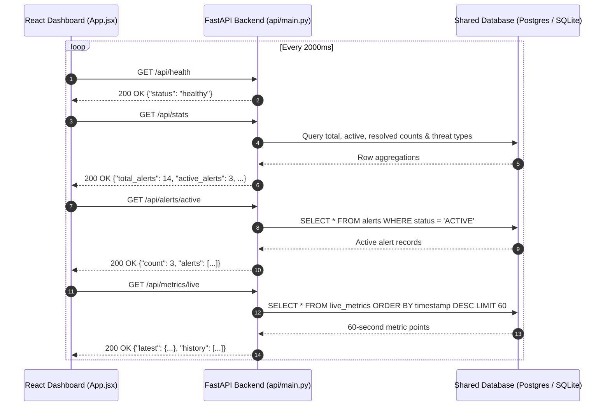
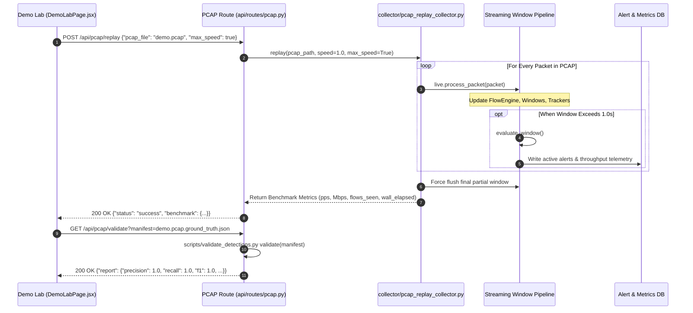

# SentinelFlow-CTD: System Architecture & Data Flow

## 1. System Architecture Overview

SentinelFlow-CTD (MONI) is structured into two cleanly separated architectural planes:

1. **The Ingest & Detection Plane (Data Plane):** Operates as a continuous background process. It ingests raw network frames from live interfaces or PCAP files, normalizes packets into bidirectional flows, aggregates metrics into multi-tiered sliding temporal windows, executes 7 heuristic and machine learning detectors, correlates multi-vector alerts, and commits state to the database.
2. **The Serving & Presentation Plane (Control & View Plane):** Operates via a FastAPI REST service and a React 19 web dashboard. The API server queries the database to serve real-time telemetry and active alert feeds to SOC operators, while providing control endpoints to generate synthetic traffic, replay PCAPs, and execute benchmark validations.

---

## 2. End-to-End System Architecture Diagram

```mermaid
flowchart TD
    subgraph DataPlane["Data Plane: Passive Ingestion & Streaming Detection"]
        direction TB
        subgraph Sources["Traffic Sources"]
            NIC["Live Network NIC<br/>(en0 / eth0)"]
            PCAP["Offline Capture<br/>(.pcap / .pcapng)"]
        end

        subgraph Ingest["Packet Ingestion"]
            SCAPY_SNIFF["collector/packet_collector.py<br/>Scapy sniff(store=False)"]
            SCAPY_REPLAY["collector/pcap_replay_collector.py<br/>Scapy PcapReader"]
            PACKET_RECORD["collector/packet_record.py<br/>Sanitized PacketRecord"]
        end

        NIC -->|Passive Tap| SCAPY_SNIFF
        PCAP -->|Read-Only Stream| SCAPY_REPLAY
        SCAPY_SNIFF --> PACKET_RECORD
        SCAPY_REPLAY --> PACKET_RECORD

        subgraph FeatureExtraction["Streaming Feature Extraction"]
            FLOW_ENG["flow/flow_engine.py<br/>Bidirectional 5-Tuple & Role Inference"]
            WIN_MGR["features/window.py<br/>WindowManager (1.0s Fixed Window)"]
            SRC_AGG["features/source_aggregation.py<br/>SourceAggregator (Per-Source Metrics)"]
            BEH_WIN["features/behavior_window.py<br/>BehaviorWindow (10s Rolling Exfil Window)"]
            BEA_TRK["features/beacon_tracker.py<br/>BeaconTracker (300s CV Timing)"]
            DNS_TRK["features/dns_tracker.py<br/>DNSTracker (30s Shannon Entropy)"]
            TLS_TRK["features/tls_tracker.py & tls_parser.py<br/>ClientHello JA3 & Structural Parser"]
        end

        PACKET_RECORD --> FLOW_ENG
        PACKET_RECORD --> WIN_MGR
        PACKET_RECORD --> SRC_AGG
        PACKET_RECORD --> BEH_WIN
        PACKET_RECORD --> BEA_TRK
        PACKET_RECORD --> DNS_TRK
        PACKET_RECORD --> TLS_TRK

        subgraph DetectionEngine["Detection & Correlation"]
            FEAT_CTX["features/feature_context.py<br/>FeatureContext Carrier Object"]
            DET_ENG["detectors/detector_engine.py<br/>DetectorEngine"]
            
            subgraph Detectors["Threat Detectors"]
                D_SCAN["scan_detector.py<br/>PORT_SCAN"]
                D_SYN["syn_flood_detector.py<br/>SYN_FLOOD"]
                D_EXFIL["exfiltration_detector.py<br/>DATA_EXFILTRATION"]
                D_BEACON["beacon_detector.py<br/>C2_BEACONING"]
                D_DGA["dga_detector.py<br/>DGA_DNS_TUNNELLING"]
                D_TLS["tls_detector.py<br/>TLS_METADATA_ANOMALY"]
                D_ML["inference/ml_detector.py<br/>ML_ANOMALY (Isolation Forest)"]
            end

            CORRELATOR["detectors/incident_correlator.py<br/>IncidentCorrelator<br/>(Scan+SYN Collapsing & Victim ML Attribution)"]
            ALERT_MGR["alerts/alert_manager.py<br/>AlertManager (Deduplication & Stale Resolution)"]
        end

        WIN_MGR -->|Every 1.0s Window Complete| FEAT_CTX
        SRC_AGG -.-> FEAT_CTX
        BEH_WIN -.-> FEAT_CTX
        BEA_TRK -.-> FEAT_CTX
        DNS_TRK -.-> FEAT_CTX
        TLS_TRK -.-> FEAT_CTX
        FLOW_ENG -.-> FEAT_CTX

        FEAT_CTX --> DET_ENG
        DET_ENG --> D_SCAN & D_SYN & D_EXFIL & D_BEACON & D_DGA & D_TLS & D_ML
        D_SCAN & D_SYN & D_EXFIL & D_BEACON & D_DGA & D_TLS & D_ML --> CORRELATOR
        CORRELATOR --> ALERT_MGR
    end

    subgraph StoragePlane["Persistence Layer"]
        ALERT_STORE["alerts/alert_store.py<br/>AlertStore"]
        METRICS_STORE["telemetry/live_metrics.py<br/>LiveMetricsStore"]
        
        DB[("Database<br/>PostgreSQL (Primary)<br/>or<br/>SQLite Fallback (ctd_alerts.db)")]
        
        ALERT_MGR --> ALERT_STORE
        WIN_MGR -->|Every 1.0s| METRICS_STORE
        ALERT_STORE --> DB
        METRICS_STORE --> DB
    end

    subgraph ControlPlane["Control & Serving Plane"]
        API["api/main.py & api/routes/*<br/>FastAPI Web Server (Port 8000)"]
        DB --> API
        
        subgraph WebClient["React 19 Frontend (Port 5173)"]
            UI_OVERVIEW["Overview Page<br/>(Threat Matrix & Kicking Counters)"]
            UI_LIVE["Live Telemetry Page<br/>(Bandwidth & Packet Histograms)"]
            UI_INCIDENTS["Incidents Page<br/>(3D Canvas Timeline & Drawer)"]
            UI_LAB["Demo Lab Page<br/>(PCAP Replay & Validation Console)"]
        end

        API -->|REST Polling (every 2000ms)| WebClient
        UI_LAB -->|Replay / Generate Triggers| API
    end
```

---

## 3. Component Deep Dive & Responsibilities

### 1. Ingestion Engine (`collector/`)
- **[pcap_replay_collector.py](file:///d:/Projects/sentinelflow-ctd/collector/pcap_replay_collector.py):** Reads `.pcap` or `.pcapng` files iteratively using Scapy's `PcapReader`. It dynamically shifts historical packet timestamps to the current wall-clock time so that the real-time sliding windows process offline files as if they were arriving live. It tracks total packets, bytes, and wall-clock duration to compute sustained pps, Mbps, and flow rates.
- **[packet_collector.py](file:///d:/Projects/sentinelflow-ctd/collector/packet_collector.py):** Listens on a physical network interface using Scapy's `sniff(store=False)`. It runs a background daemon thread (`background_flusher`) that wakes every 500ms to evaluate completed observation windows during network idle periods and auto-resolve stale alerts.

### 2. Flow Tracking Engine (`flow/flow_engine.py`)
- Maintains an in-memory dictionary of bidirectional 5-tuples: `(src_ip, src_port, dst_ip, dst_port, protocol)`.
- Orders endpoints symmetrically so that forward and reverse packets are assigned to the same flow instance:
  $$\text{endpoint}_A = (\text{src\_ip}, \text{src\_port}), \quad \text{endpoint}_B = (\text{dst\_ip}, \text{dst\_port})$$
  $$\text{key} = (\min(\text{endpoint}_A, \text{endpoint}_B), \max(\text{endpoint}_A, \text{endpoint}_B), \text{protocol})$$
- Evaluates TCP handshake flags to infer roles:
  - `flags == 'S'` (SYN only) $\implies$ Sender is `initiator_ip`, Receiver is `responder_ip`.
  - `flags == 'SA'` (SYN+ACK) $\implies$ Sender is `responder_ip`, Receiver is `initiator_ip`.

### 3. Multi-Horizon Streaming Feature Trackers (`features/`)
To detect threats spanning different time scales without unbounded memory consumption, features are collected across four distinct temporal granularities:

```
┌─────────────────────────────────────────────────────────────┐
│ 1-Second Fixed Window (WindowManager)                       │
│ -> Immediate network volume, pps, Mbps, active flows        │
└─────────────────────────────────────────────────────────────┘
┌─────────────────────────────────────────────────────────────┐
│ 10-Second Rolling Window (BehaviorWindow)                   │
│ -> Data exfiltration volume & asymmetric byte ratios        │
└─────────────────────────────────────────────────────────────┘
┌─────────────────────────────────────────────────────────────┐
│ 30-Second Rolling Window (DNSTracker)                       │
│ -> Shannon entropy of DNS domain queries & query velocity   │
└─────────────────────────────────────────────────────────────┘
┌─────────────────────────────────────────────────────────────┐
│ 300-Second Rolling Window (BeaconTracker & TLSTracker)      │
│ -> C2 check-in Coefficient of Variation & JA3 repetitions   │
└─────────────────────────────────────────────────────────────┘
```

- **`WindowManager` (1.0s):** Serves as the primary clock for the detection pipeline. Every packet is passed to `add_packet()`. When a packet's timestamp reaches or exceeds `window_start + 1.0`, the completed window is sealed, converted to a feature vector, and emitted to `evaluate_window()`.
- **`BehaviorWindow` (10.0s):** Holds a rolling double-ended queue (`deque`) of packet headers. Used specifically by `exfiltration_detector.py` to identify sustained outbound byte volumes and outbound-to-inbound byte ratios exceeding $5.0\times$.
- **`BeaconTracker` (300.0s):** Records the start timestamp of every brand-new non-DNS flow per `(src_ip, dst_ip)`. For every source contacting a repeated destination $\ge 4$ times, it calculates the mean inter-arrival time ($\mu$) and standard deviation ($\sigma$). The **Coefficient of Variation ($CV = \sigma / \mu$)** determines timing regularity. A $CV \le 0.25$ indicates programmatic, robot-like beacon check-ins.
- **`DNSTracker` (30.0s):** Extracts cleartext domain queries from UDP port 53. Calculates the Shannon entropy:
  $$H = -\sum_{i=1}^{n} P(x_i) \log_2 P(x_i)$$
  Domain strings with $H \ge 3.5$ and lengths $\ge 35$ characters indicate DGA (Domain Generation Algorithms) or DNS data smuggling.
- **`TLSTracker` (300.0s) & `tls_parser.py`:** Parses raw TCP payloads on port 443 looking for TLS `ClientHello` handshakes (`0x16` record, `0x01` handshake). Extracts cipher suite count, extension count, SNI presence, and computes JA3 hashes without decrypting application data.

### 4. Hybrid Detection & Correlation Engine (`detectors/`)
- **`DetectorEngine` ([detectors/detector_engine.py](file:///d:/Projects/sentinelflow-ctd/detectors/detector_engine.py)):** Unifies all feature streams into a `FeatureContext` and evaluates all source-level detectors in parallel for every active IP in that window.
- **`IncidentCorrelator` ([detectors/incident_correlator.py](file:///d:/Projects/sentinelflow-ctd/detectors/incident_correlator.py)):** Solves the operational problem of alert duplication:
  - **Overlapping Scan + SYN:** If a host exhibits multi-port reconnaissance ($\ge 10$ unique ports) and also triggers the SYN flood detector, the SYN flood signal is collapsed into the `PORT_SCAN` alert as supporting evidence.
  - **Victim Impact Attribution:** If an external attacker floods a victim server and the victim subsequently exhibits an `ML_ANOMALY` due to degraded performance, the correlator links the victim's ML anomaly to the attacker's `SYN_FLOOD` alert as impact evidence, removing the victim from the attacker list.
  - **ML Corroboration:** When both a rule detector and the ML Isolation Forest flag a source, the rule alert remains primary, while the ML confidence score and z-score reasons are attached as corroborating evidence.

### 5. State & Persistence Engine (`alerts/` & `telemetry/`)
- **`AlertManager` ([alerts/alert_manager.py](file:///d:/Projects/sentinelflow-ctd/alerts/alert_manager.py)):** Manages incident lifecycles. New alerts are inserted as `ACTIVE`. Subsequent detections for the same `(source_ip, attack_type)` update `last_seen`, increment `event_count`, and elevate confidence. Alerts inactive for $\ge 300\text{ seconds}$ are automatically marked `RESOLVED`.
- **`AlertStore` ([alerts/alert_store.py](file:///d:/Projects/sentinelflow-ctd/alerts/alert_store.py)):** Manages dual-engine persistence. It probes `DATABASE_URL`; if PostgreSQL connects successfully, it creates the relational table with native `JSONB` support. If PostgreSQL is absent or fails, it automatically initializes and manages SQLite (`ctd_alerts.db`).
- **`LiveMetricsStore` ([telemetry/live_metrics.py](file:///d:/Projects/sentinelflow-ctd/telemetry/live_metrics.py)):** Stores a rolling 60-second window of network throughput (pps, Mbps, flows/sec, packet totals). Automatically prunes records older than the latest 60 entries.

---

## 4. Frontend-to-Backend Sequence Diagrams

### 1. Periodic Telemetry & Alert Polling Cycle
The React application (`App.jsx`) executes a polling loop every 2,000 milliseconds:



### 2. PCAP Benchmark Replay Workflow
When an operator triggers a benchmark replay from the Demo Lab page:



---

## 5. Third-Party Integrations & External Services

- **Zero External SaaS / Cloud Telemetry:** SentinelFlow-CTD requires no connection to external cloud APIs, threat intelligence feeds, or licensing servers. It is fully operational in strictly air-gapped environments.
- **PostgreSQL Database:** The only supported external dependency is an optional PostgreSQL server. If not configured in `.env`, the system runs without modification on local SQLite files.
